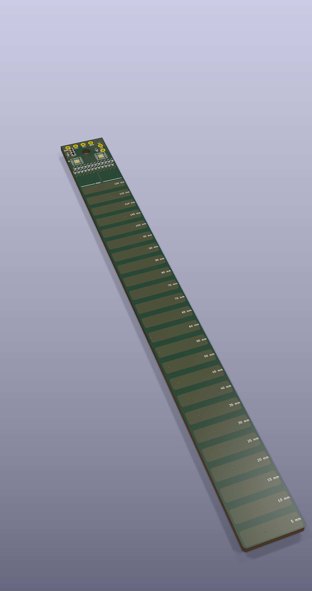
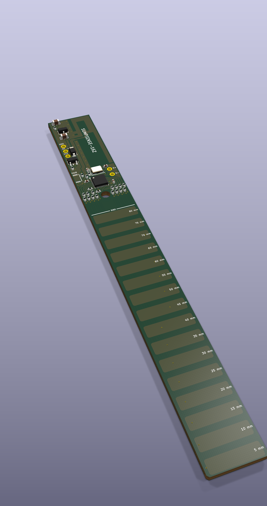

# SumpSense

Kapazitive Füllstandssensoren für 14,5-mm-Rohr: ein schmaler Stab mit Elektroden im 5-mm-Raster, Elektronik am trockenen Ende. Die erste Variante ist eine 14-mm-Fassung des [Seeed Grove Water Level Sensor](https://wiki.seeedstudio.com/Grove-Water-Level-Sensor/).

## Varianten

Name = **SumpSense-** + Zahl der Stufen + Schnittstelle (`z` Zigbee, `i` I²C).

<table>
  <tr>
    <th>SumpSense-24i (I²C)</th>
    <th>SumpSense-16z (Zigbee)</th>
  </tr>
  <tr>
    <td></td>
    <td></td>
  </tr>
</table>

- **SumpSense-24i**: 24 Stufen, zwei ATtiny1616, I²C über sechs Lötlöcher. Platine, Flashen, Betrieb: [`hardware/sumpsense-24i/README.md`](hardware/sumpsense-24i/README.md)
- **SumpSense-16z**: 16 Stufen, ESP32-H2 mit Zigbee, Ventilausgang: [`hardware/sumpsense-16z/README.md`](hardware/sumpsense-16z/README.md)
- Firmware-HEX und `flash.sh` (SumpSense-24i): [`firmware/README.md`](firmware/README.md)
- Arduino-I²C-Test (Seeed-Protokoll, 8 Bytes/Lesevorgang): [`examples/water-level-sensor-demo.ino`](examples/water-level-sensor-demo.ino)
- Fertigungsdaten für JLCPCB je Platine in `hardware/<platine>/jlcpcb/`, erzeugt mit [`hardware/jlcpcb.py`](hardware/jlcpcb.py)
