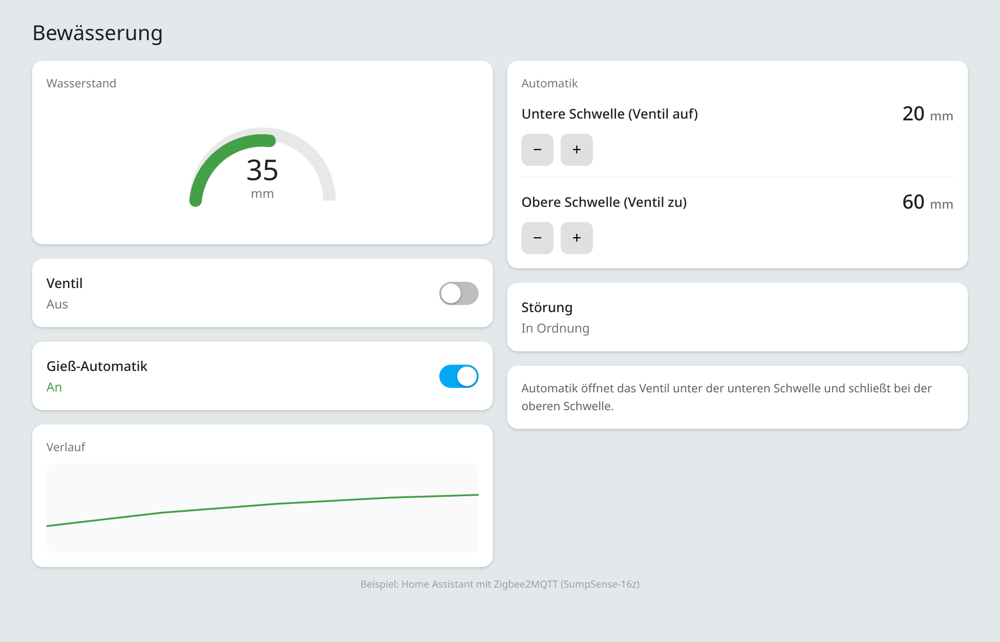

# Firmware

| Platine | Ordner | Toolchain |
|---------|--------|-----------|
| SumpSense-24i | [`sumpsense-24i/`](sumpsense-24i/) | [megaTinyCore](https://github.com/SpenceKonde/megaTinyCore) 2.6.x |
| SumpSense-16z | [`sumpsense-16z/`](sumpsense-16z/) | [arduino-esp32](https://github.com/espressif/arduino-esp32) 3.3.x, Zigbee ZCZR |

---

## SumpSense-24i

I²C wie Seeed Grove Water Level Sensor (**0x77** Spitze, **0x78** Kopf), je 12 Bytes (0 = trocken, 0xFF = nass). Seeed-Demo liest nur 8 Bytes von 0x77 — für 24 Stufen beide Adressen voll lesen.

### Bauen & Flashen

```bash
arduino-cli compile -b megaTinyCore:megaavr:atxy6:chip=1616,clock=10internal --output-dir sumpsense-24i/build sumpsense-24i
UPDI_PORT=/dev/ttyACM0 ./flash.sh u1
UPDI_PORT=/dev/ttyACM0 ./flash.sh u2
```

Hardware: [`../hardware/sumpsense-24i/README.md`](../hardware/sumpsense-24i/README.md).

### Nutzen

Master pollt **0x77** und **0x78**. Optional Register ab **0x10** (Rohwerte) nach I²C-Schreibzugriff — Details in Quelltext `sumpsense-24i.ino`. Kalibrieration trocken: Register **0x7F** = `0xCA`.

Tests: `python3 sumpsense-24i/test/run_tests.py`

---

## SumpSense-16z

Zigbee-3.0-Router (ESP32-H2 **4 MB**). Endpoints: Wasserstand (mm), Ventil, Gieß-Automatik, Untere/Obere Schwelle, Störung, OTA.

### Bauen & Flashen

```bash
arduino-cli compile -b "esp32:esp32:esp32h2:ZigbeeMode=zczr,PartitionScheme=zigbee_zczr,CDCOnBoot=cdc" --output-dir sumpsense-16z/build sumpsense-16z
```

**Erstes Mal:** JP1 **PAIR** schließen → 5 V/GND an J1 → PAIR öffnen → USB an J3 → Upload:

```bash
arduino-cli upload -b "esp32:esp32:esp32h2:ZigbeeMode=zczr,PartitionScheme=zigbee_zczr,CDCOnBoot=cdc" -p /dev/ttyACM0 sumpsense-16z
```

Danach: USB oder OTA (Zigbee2MQTT). Hardware: [`../hardware/sumpsense-16z/README.md`](../hardware/sumpsense-16z/README.md).

### Pairing & Bedienung (JP1 PAIR)

| PAIR | Wirkung |
|------|---------|
| kurz | Messwerte senden |
| 3 s | Trocken-Kalibrierung |
| 6 s | Neu pairen |
| 12 s | Werksreset |
| beim Einschalten | Download-Modus (nur leerer Flash) |

Neues Gerät: Koordinator **Permit join**, Sensor einschalten.

### Smart Home

Dashboard „Bewässerung“ in Home Assistant (ZHA oder Zigbee2MQTT):



| System | Hinweis |
|--------|---------|
| **Home Assistant (ZHA)** | direkt — Stand, Ventil, Automatik, Schwellen |
| **Zigbee2MQTT** | Konverter [`sumpsense-16z/z2m/sumpsense-16z.mjs`](sumpsense-16z/z2m/sumpsense-16z.mjs) nach `data/external_converters/` |
| **Tuya / Google Home** | vor allem Schalter; voller Stand eher über HA |

Tests: `python3 sumpsense-16z/test/run_tests.py` · `cd sumpsense-16z/z2m && node test_converter.mjs`
