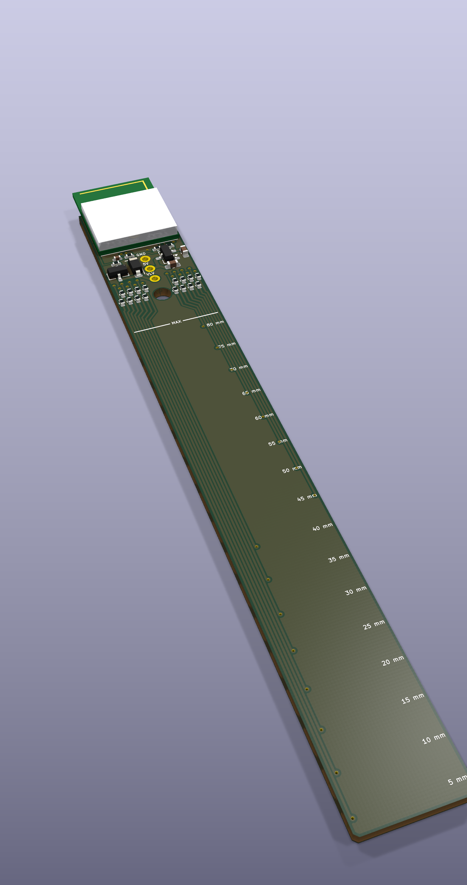

# SumpSense-16z-v2

Wie [SumpSense-16z](../sumpsense-16z/README.md), aber mit dem Modul **ESP32-H2-MINI-1-H4S** statt nacktem Chip: Quarz und Antenne sitzen im Modul, Quarz, Leiterantenne und Anpassnetz entfallen. Platine **14 × 109,3 mm**, die Modulantenne steht **5,4 mm** über (gesamt 114,7 mm; v1: 125 mm). Rohr **14,5 mm**, 16 Stufen à **5 mm**, Ausgang für **5-V-Magnetventil**.

## v1 oder v2?

| | v1 (`sumpsense-16z`) | v2 (`sumpsense-16z-v2`) |
|---|---|---|
| Funk | ESP32-H2FH4 + 32-MHz-Quarz + Leiterantenne DN007 | ESP32-H2-MINI-1-H4S (Quarz, Antenne, Funkzulassung im Modul) |
| Länge | 125 mm | 109,3 mm Platine + 5,4 mm Antenne = 114,7 mm |
| Bauhöhe Kopf | ca. 1,2 mm | **2,4 mm** (Modul) |
| LCSC-Lage | Chip „nicht für neue Designs“, Restbestand | Modul neu, Bestand schwankt |
| Teilepreis Funk (1 Stk.) | ≈ 2,19 $ | ≈ 3,77 $ |

Beide Platinen bleiben gepflegt: v1 fertigen, wenn das Modul nicht lieferbar ist.

## Platine bestellen (JLCPCB)

1. [`jlcpcb/`](jlcpcb/): Gerber-ZIP, BOM, CPL. Neu generieren: `python3 ../jlcpcb.py sumpsense-16z-v2`
2. **PCBA einseitig (oben):** Gerber, BOM und CPL hochladen. Die Pads auf der Unterseite (J3, JP1) werden nicht bestückt.
3. **Antenne steht über die Platine:** So empfehlen es Espressif und JLCPCB selbst für Module mit Leiterantenne. JLCPCB bestückt nur mit Nutzenrand; der Rand darf nur an den Längsseiten liegen, am Antennenende muss frei bleiben. In der Bestellung als Bemerkung angeben: *„ESP32 module antenna overhangs the board edge on purpose, edge rails on the long sides only“*.
4. In der Bestückungsvorschau prüfen, dass die **Antenne des Moduls über das Platinenende** zeigt (CPL-Drehung des Moduls ist nicht gegen eine echte Bestellung geprüft).

## Anschluss

| Wo | Funktion |
|----|----------|
| **J1** Löcher GND, 5V, VLV (Mitte, vor der Schraube) | Versorgung; Ventil zwischen **5V** und **VLV** |
| **J3** Pads D+, D− (Unterseite, Antennenende) | USB nur zum Flashen |
| **JP1 PAIR** Pads (Unterseite, neben J3) | GPIO9 auf GND: Pairing, Werksreset, Download-Modus |

## Aufbau

- **Modul am Platinenende**, nur der Antennenteil (5,4 mm) steht über; die Platinenkante liegt auf der Antennengrenze, 0,3 mm vor den äußeren GND-Pads.
- **Vias unter dem Modul:** Seitenpins und Endreihe gehen direkt unter dem Modul auf die Unterseite, außen sitzt nur das Via für IO22. Dadurch beginnen die Bauteile direkt hinter dem Modul.
- **J1 mittig vor der Schraube MH1:** oben Regler U2 mit C3/C4 und den Pull-ups R17/R18, unten Ventiltreiber Q1/D1/R23 und EN-Beschaltung R19/C6.
- **Alle 16 Sense-Leitungen auf der Unterseite**, oben und unten an J1 vorbei, kreuzungsfrei; vor der Widerstandsbank gehen sie in zwei Via-Spalten nach oben.
- **Bahnbreiten:** Sense 0,2 mm, 3V3 0,3–0,4 mm, GND 0,4 mm, 5V und Ventil 0,5 mm, Elektroden 0,25 mm.
- **GPIO-Zuordnung** folgt der Modul-Pinreihe (E01…E16 = GPIO 10, 11, 8, 9, 25, 22, 23, 24, 5, 4, 12, 14, 13, 1, 3, 2). Die Firmware braucht dafür `SS_BOARD=2`.
- **EN** mit 10 kΩ / 1 µF (R19, C6) nach Datenblatt; **VBAT** bleibt offen (im Modul an 3V3).
- Pull-ups **R17/R18 (1 MΩ)** an GPIO8/9 wie bei v1 (Messverfahren und Strapping).
- Der Schaltplan wird mit `python3 gen_sch.py` aus der Platine erzeugt.

## Firmware, Pairing, Smart Home

**[Firmware-README](../../firmware/README.md#sumpsense-16z)**: Bauen mit `SS_BOARD=2`, Flashen, PAIR-Tabelle, Home Assistant. Zigbee-Modell und Zigbee2MQTT-Konverter sind dieselben wie bei v1; OTA-Images haben einen eigenen Image-Typ (0x1012), damit v1- und v2-Images nicht vertauscht werden.

## Ungeprüft

- Kein Musteraufbau: Antennenleistung im Rohr, Kapazitätsmessung und Einschaltverhalten (EN-RC) sind nur nach Datenblatt ausgelegt.
- Überstehende Antenne bei JLCPCB nicht mit einer echten Bestellung geprüft (Nutzenrand siehe oben).
- Das Landmuster des Moduls ist nach Espressifs KiCad-Bibliothek nachgebaut; das 3D-Modell ist vereinfacht.
