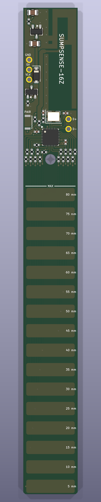
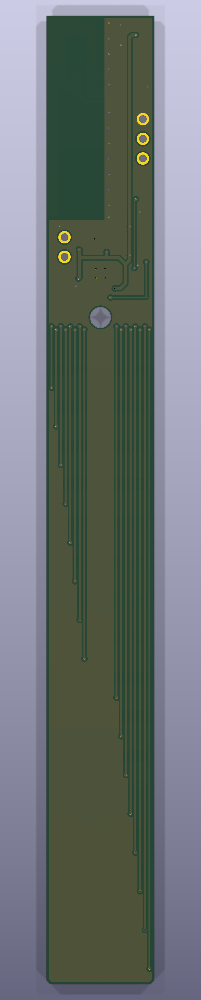
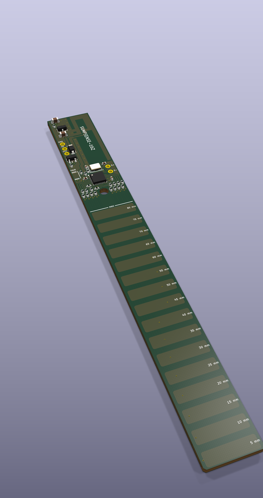

# SumpSense-16z

Zweite Platine neben [`sumpsense-24i`](../sumpsense-24i/README.md). Ein **ESP32-H2**, **16** kapazitive Stufen, Inverted-F auf der Platine, Low-Side-Ausgang für ein **5-V-Magnetventil**. Kein I2C, kein zweiter Controller.

Platine **14,0 × 125,0 mm**, **1,6 mm**, zwei Lagen. Rohr **14,5 mm**. Stufenabstand **5 mm**, Messlänge etwa **8 cm**. Elektrodenmaß wie die I2C-Platine (3,4 mm × 12,5 mm). **M2,5** in der Mitte (y = 7 mm) zwischen den beiden Widerstandsblöcken, Bohrung 2,7 mm, damit der bestehende Clip passt. Der Kopf einer M2,5-Schraube (Ø 4,5 mm) liegt auf den nächsten 0402 auf: Unterlegscheibe oder Clip nur auf der Unterseite ansetzen. Antenne, Quarz, H2 und alle Löcher liegen auf der trockenen Seite der Linie **MAX**. Zwischen den Elektroden-Vias hinter dem Widerstandsblock und der Linie MAX liegen etwa 5 mm freie Platine: Taucht der Stab etwas tiefer ein, bleibt die Elektronik trotzdem trocken.

## Ansichten

<table>
  <tr>
    <th>Oberseite</th>
    <th>Unterseite</th>
    <th>Layout</th>
    <th>3D</th>
  </tr>
  <tr>
    <td></td>
    <td></td>
    <td></td>
    <td></td>
  </tr>
</table>

Kopf mit Antenne, Regler, Ventiltreiber, H2 und Widerstandsblöcken:

Schaltplan: [`preview/schaltplan.pdf`](preview/schaltplan.pdf) · [SVG](preview/schaltplan.svg)

Neu erzeugen: `python3 render_kicad.py` (Oberseite, Unterseite, 3D, Layout, Kopf), `python3 gen_sch.py` und `python3 export_sch.py` (Schaltplan). Alle drei brauchen KiCad, siehe [`../kicad_tools.py`](../kicad_tools.py).

## Aufbau

Der Kopf hat drei Bereiche:

- **Antenne** (die ersten 26,6 mm, obere Hälfte, bis 0,5 mm hinter das offene Ende): nur das Kupfer der Antenne, sonst nichts, auf keiner Lage. Das ganze Rechteck aus DN007 bleibt frei, nicht nur die Kupferform.
- **Streifen unter der Antenne** (y 7,5–14 mm): Massefläche der Antenne. Darauf Regler U2, C3, C4, R22, Ventiltreiber Q1, D1, R23, die Löcher J1 und der Taster SW1.
- **Rechts neben der Antenne**: Quarz, ESP32-H2, Flash-Löcher, zwei Widerstandsblöcke ober- und unterhalb des Clip-Lochs, direkt hinter dem Chip.

Die Stufen laufen auf der Unterseite gerade vom Widerstand bis zu einem Via in der jeweiligen Elektrode.

## Anschluss

Löcher im Raster **2,54 mm**, kein Steckverbinder. J1 und J3 liegen auch zueinander in einem gemeinsamen 2,54-mm-Raster: eine Lochrasterplatine passt auf alle fünf Löcher zugleich. Bei J1 steht die Beschriftung quer links neben dem jeweiligen Loch, darüber ist bestückt.

| Löcher | Pins | Rolle |
|--------|------|--------|
| J1 | GND, 5V, VLV | Versorgung an GND/5V. Magnetventil zwischen 5V und VLV (Drain) |
| J3 | D+, D− | USB zum Flashen |
| SW1 | Taster an GPIO9 | Pairing, Werksreset, BOOT beim Einschalten |

Freilaufdiode auf der Platine: Kathode an 5 V, Anode am Drain.

## Pinbelegung

E01 liegt direkt hinter der Linie MAX (0,5 mm), E16 an der Spitze. Auf jeder Elektrode steht quer die Eintauchtiefe, ab der sie im Wasser liegt: **5 mm** an E16 (Spitze) bis **80 mm** an E01. Jede Stufe hängt über **100 kΩ** am GPIO.

| Stufe | GPIO | Zusatz |
|-------|------|--------|
| E01 | GPIO25 | Strapping (JTAG-Quelle). JTAG_SEL_ENABLE nicht brennen |
| E02 | GPIO24 | U0TXD, beim Booten gibt das ROM hier kurz Text aus |
| E03 | GPIO23 | U0RXD |
| E04 | GPIO22 | |
| E05–E08 | GPIO14, GPIO13, GPIO12, GPIO11 | |
| E09 | GPIO10 | |
| E10 | GPIO9 | BOOT. 10 kΩ nach 3,3 V, Taster SW1 nach GND |
| E11 | GPIO8 | 10 kΩ nach 3,3 V |
| E12–E16 | GPIO5, GPIO4, GPIO3, GPIO2, GPIO1 | |

Weiter fest: **GPIO0** ist das Gate des AO3400A, 100 kΩ nach GND, kein Vorwiderstand. GPIO0 ist kein Strapping-Pin, das Ventil bleibt beim Start aus. **GPIO27 = D+**, **GPIO26 = D−**, ohne Serienwiderstand. **EN (Pin 17)** liegt direkt an 3,3 V, ohne die 10 kΩ und 1 µF aus dem Espressif-Guide. Kein 32-kHz-Quarz, keine Ferritperle, kein Buck.

Pinbelegung des QFN32 nach Espressif-Datenblatt v1.3, Bild 2-1 (Draufsicht, Pin 1 oben links, gegen den Uhrzeigersinn). Der Footprint ist der aus der KiCad-Bibliothek, `QFN-32-1EP_4x4mm_P0.4mm_EP2.65x2.65mm`, um 90° gedreht: ANT (Pin 32) zeigt zur Antenne.

## Taster SW1

**SW1** (C&K KXT3, 3 × 2 mm, an der Unterkante neben R18, Beschriftung PAIR) zieht GPIO9 nach GND. Er ersetzt die frühere Lötbrücke J4, die Platine bleibt 14,0 × 125,0 mm.

- **Kurz drücken:** Zigbee-Pairing starten (Netz verlassen und neu suchen).
- **10 s halten:** Werksreset (Zigbee-Daten und Einstellungen löschen).
- **Beim Einschalten gedrückt halten:** Download-Modus für den ersten Flash.

GPIO9 ist zugleich die Stufe E10. Die Firmware treibt den Pin nie auf High, sondern entlädt nur nach GND und misst die Ladezeit über den Pull-up. Ein gedrückter Taster ist deshalb kein Kurzschluss, die Messung von E10 läuft dann in den Timeout und wird als Tastendruck gewertet.

## Flashen

Leerer Flash bootet nur in den Download, wenn **GPIO8 = 1** und **GPIO9 = 0**. GPIO8 hat die 10 kΩ nach 3,3 V, GPIO9 zieht der Taster auf GND.

1. SW1 gedrückt halten.
2. 5 V und GND an J1 legen. J3 führt keine Versorgung.
3. SW1 loslassen. USB an J3 (D+, D−). Der Port erscheint als `/dev/ttyACM*`. Ohne den 32-MHz-Quarz zählt USB nicht.
4. Flashen, danach **Strom aus**. Ein Reset über USB liest den Strap nicht neu.

Spätere Flashes brauchen den Taster nicht, solange die Firmware USB Serial/JTAG auf GPIO26/GPIO27 anlässt. Firmware und Bauanleitung: [`../../firmware/sumpsense-16z/`](../../firmware/sumpsense-16z/).

## Antenne und HF

Inverted-F nach **TI DN007**, Dokument **SWRU120D** Rev. D, 25,7 × 7,5 mm. Das Polygon stammt aus dem KiCad-Modul `PCB_IF_ANT_2.4G` (tommag/kicad-lib), das diese Maße abbildet. Die Espressif-Freihaltezone von 15 mm passt auf 14 mm Breite nicht. Das ist Absicht: der Kopf wird nicht breiter.

Die Massefläche (Ober- und Unterseite) beginnt an der Unterkante der beiden Kurzschluss-Zähne und ist dort mit ihnen verbunden, wie in DN007 Bild 1-1. Die Antenne ist deshalb ein Net-Tie-Footprint (A1) mit Pad 1 = RF am Speiseschenkel und Pad 2 = GND an den Zähnen. Neben dem Speiseschenkel bleiben 0,45 mm frei (DN007: L8). Eine Reihe GND-Vias näht die Fläche entlang der Antenne.

Die Speiseleitung ist **koplanar mit Masse**: 1,0 mm Leiter, 0,2 mm Spalt, Masse oben daneben und unten darunter. Auf 1,6 mm FR4 liegt das grob bei 50 Ω (gerechnet, nicht gemessen).

**R20** (0 Ω) sitzt statt der 24 nH auf XTAL_P, **R21** (0 Ω) statt der 2–3 nH in der Antennenleitung. Die Shunt-Kondensatoren des CLC-Glieds fehlen. Die beiden Brücken sind die Stellen für einen späteren Spulentausch ohne neues Layout. Mit den Brücken kann die Reichweite geringer sein.

Quarz **32 MHz**, ±10 ppm, Last 8 pF, dazu zwei **12 pF** C0G. Pad 1 und Pad 3 sind der Quarz, Pad 2 und Pad 4 Masse. R20 liegt zwischen Chip-Pin 29 und Quarz-Pad 1.

3,3 V macht ein **XC6206P332MR** (SOT-23, 200 mA). Der H2 zieht laut Datenblatt (Tab. 5-7) beim Senden mit +20 dBm höchstens 140 mA. 10 µF an 5 V, 10 µF an 3,3 V, zwei 100 nF an den Versorgungs-Pins des H2. R22 ist eine 0-Ω-Brücke zwischen Regler und 3,3 V.

## Stückliste

C-Nummern nur, wo sie geprüft sind. Der Rest ist die Klasse, ohne erfundene Nummer.

| Ref | Wert | Gehäuse | Klasse |
|-----|------|---------|--------|
| U1 | ESP32-H2 | QFN32 4×4, 0,4 mm | Extended. Bestellcode beim Bestellen prüfen. ESP32-H2FH4 (LCSC C22470214) ist NRND |
| U2 | XC6206P332MR | SOT-23 | Basic, C5446. Pin 1 GND, 2 VOUT, 3 VIN |
| Q1 | AO3400A | SOT-23 | Basic, C20917. Low-Side, Source an GND |
| D1 | SS14 | SOD-123 | Basic-Liste. Pad 1 = Kathode an 5 V. Keine C-Nummer festgelegt |
| Y1 | 32 MHz, ±10 ppm, Last 8 pF | 3225 | Extended |
| C1, C2 | 12 pF, C0G | 0402 | Basic |
| C3, C4 | 10 µF | 0805 | Basic |
| C5, C6 | 100 nF | 0402 | Basic |
| R1–R16 | 100 kΩ | 0402 | Basic, Serie zur Elektrode |
| R17, R18 | 10 kΩ | 0402 | Basic, GPIO8 und GPIO9 nach 3,3 V |
| R20, R21, R22 | 0 Ω | 0402 | Basic, Quarz-, Antennen- und Reglerbrücke |
| R23 | 100 kΩ | 0402 | Basic, Gate nach GND |
| MH1 | M2,5 | Bohrung 2,7 mm | Clip-Loch |
| SW1 | KXT311LHS | 3,0 × 2,0 mm SMD | Taster, Extended. C-Nummer beim Bestellen prüfen |
| J1, J3 | – | Loch 1,0 mm, Pad 1,6 mm | nicht bestückt |

Vias 0,45/0,2 mm. Bei JLCPCB vor der Bestellung prüfen, ob 0,2-mm-Bohrungen für zwei Lagen Aufpreis kosten.

## Dateien

`sumpsense-16z.kicad_pcb` ist die Quelle und wird in KiCad gepflegt. `python3 gen_sch.py` liest Bauteile, Pads und Netze aus der Platine und schreibt daraus den Netzlisten-Schaltplan. Der KiCad-Abgleich Platine ↔ Schaltplan ist damit ohne Netzabweichung.

Fertigungsdaten für JLCPCB (Gerber-ZIP, BOM, Bestückungsliste): [`jlcpcb/`](jlcpcb/), neu erzeugen mit `python3 ../jlcpcb.py sumpsense-16z`. ESP32-H2, Quarz, SS14 und SW1 haben noch keine feste LCSC-Nummer und werden im BOM-Werkzeug von JLC zugeordnet; die Drehung der Bauteile in der Bestückungsvorschau von JLC prüfen.
