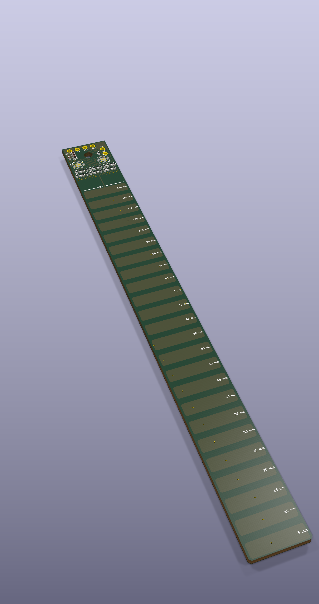

# SumpSense-24i

24 kapazitive Stufen, **2× ATtiny1616**, **I²C** (Seeed-kompatibel **0x78** / **0x77**). **14 × 141 mm**, Rohr **14,5 mm**, Stufen **5 mm** (120 mm Messbereich).

## Platine bestellen (JLCPCB)

1. [`jlcpcb/`](jlcpcb/): Gerber-ZIP, BOM, CPL.
2. Neu: `python3 ../jlcpcb.py sumpsense-24i`
3. **PCBA:** alle drei hochladen; Vias **0,45/0,3 mm** (Standardloch, kein 0,2-mm-Aufpreis). Economic: **Extended** für ATtiny (**C507118**, zwei Stück, eine LCSC-Zeile). **JLC-Vorschau:** Pin-1-Markierung bei U1/U2 mit Footprint prüfen (CPL-Drehung ist korrigiert).

## Anschluss

**J1** (2,54 mm): GND, VCC (3,3–5 V), SCL, SDA, UPDI U1, UPDI U2. Pull-ups auf der Platine. Füllstand: nasse Stufen am Stück ab **0x77** Byte 0, dann **0x78** Byte 0, × 5 mm.

## Firmware & Nutzen

Bauen, Flashen (UPDI U1 + U2), I²C-Nutzung: **[Firmware-README](../../firmware/README.md#sumpsense-24i)**.
