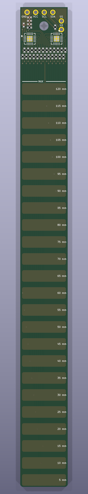
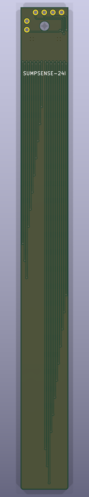

# SumpSense-24i

Kapazitiver Füllstandssensor für **14,5-mm-Rohr** (Platine **14,0 × 141,1 mm**), **24 Stufen** im Abstand von **5 mm**, Messbereich **120 mm**. Schaltungsprinzip wie der [Seeed Grove Water Level Sensor (10 cm)](https://wiki.seeedstudio.com/Grove-Water-Level-Sensor/): zwei **ATtiny1616** am **I2C**, **U1** = **12** Stufen am trockenen Ende (**0x78**), **U2** = **12** Stufen zur Spitze (**0x77**). Jeder Chip nutzt alle 12 Touch-Kanäle (PA4–PA7, PB0, PB1, PB4, PB5, PC0–PC3).

Statt Grove-Stecker gibt es **sechs Löcher im 2,54-mm-Raster** zum Anlöten eines Kabels oder einer Stiftleiste. Linie **MAX**: nicht tiefer eintauchen. Zwischen den Elektroden-Vias hinter dem Widerstandsblock und der Linie MAX liegen 5 mm freie Platine, damit die Elektronik trocken bleibt, auch wenn der Stab etwas tiefer eintaucht. Auf jeder Elektrode steht quer die Eintauchtiefe: **5 mm** an E24 (Spitze) bis **120 mm** an E1.

## Ansichten

<table>
  <tr>
    <th>Oberseite</th>
    <th>Unterseite</th>
    <th>Layout</th>
    <th>3D</th>
  </tr>
  <tr>
    <td></td>
    <td></td>
    <td></td>
    <td></td>
  </tr>
</table>

Kopf mit Anschlusslöchern, Controllern und Widerständen:


Schaltplan: [`preview/schaltplan.pdf`](preview/schaltplan.pdf) · [SVG](preview/schaltplan.svg)

Neu erzeugen: `python3 render_kicad.py` (Oberseite, Unterseite, 3D, Layout, Kopf), `python3 gen_sch.py` und `python3 export_sch.py` (Schaltplan). Alle brauchen KiCad, siehe [`../kicad_tools.py`](../kicad_tools.py).

## Anschluss

Sechs Löcher **J1** am trockenen Ende, alle im gemeinsamen 2,54-mm-Raster (Draufsicht, trockenes Ende oben):

```
 GND  VCC  SCL  SDA   .
  .    .    .    .   U1
  .    .    .    .   U2
```

| Loch | Signal | Verwendung |
|------|--------|------------|
| GND | Masse | Betrieb und Flashen |
| VCC | 3,3 V oder 5 V | Betrieb und Flashen |
| SCL, SDA | I2C | Betrieb (Pull-ups 4,7 kΩ auf der Platine) |
| U1, U2 | UPDI des jeweiligen Chips | nur zum Flashen |

Der Master liest **0x78** (U1) und **0x77** (U2), je **12** Werte.

## Flashen (Adafruit UPDI Friend)

GND und VCC vom UPDI Friend an GND/VCC, UPDI nacheinander an **U1**, dann **U2**. I2C dabei nicht angeschlossen, nur eine Spannungsquelle.

```bash
cd ../../firmware
UPDI_PORT=/dev/ttyACM0 ./flash.sh u1
UPDI_PORT=/dev/ttyACM0 ./flash.sh u2
```

Details, Firmware-Quellen, Dump vom Original-Sensor: [`../../firmware/README.md`](../../firmware/README.md).

**Firmware:** Seeed veröffentlicht die MCU-Firmware nicht. Das Seeed-Protokoll liefert 12 Werte von 0x78 und **8** von 0x77; für die 24i muss U2 ebenfalls 12 Werte liefern (PC0–PC3 zusätzlich) und der Master 2 × 12 lesen. Die Community-Firmware (`community/`) ist dafür anzupassen.

## Aufbau

- **Kopf:** sechs Anschlusslöcher, daneben eine Reihe mit Abblockung (C1, C4, C2: 100 nF, 2 × 4,7 µF) und dem SDA-Pull-up R2, C3 (100 nF) direkt an U2, der SCL-Pull-up R1 an U1. M2,5-Loch auf der Mittellinie vor den Chips, zwei ATtiny1616 (VQFN-20, 3 × 3 mm) übereinander. Die Busleitungen zu U1 laufen oben, SDA, SCL, UPDI und VCC zu U2 auf der Unterseite und kommen links neben U2 über Vias hoch. Beide Chips liegen im 0,4-mm-Pinraster genau übereinander auf der Mittellinie der Widerstandsbahnen.
- **Stufen:** 24 Serienwiderstände 1 kΩ (R3–R26) in zwei versetzten Spalten, zwei versetzte Via-Reihen, Elektrodenbahnen auf der Unterseite gerade bis zu einem Via in der jeweiligen Elektrode. Nur E1 (direkt hinter MAX) wird oben von R3 bis an die Elektrode geführt: Dadurch bleibt unten eine Gasse frei, über die die GND-Fläche der Unterseite bis in den Elektrodenbereich fließt und dort die frei werdenden Flächen füllt. Der Schriftzug SUMPSENSE-24I steht auf der Unterseite, damit oben nichts über der E1-Leitung liegt. Elektroden 3,4 × 13 mm.
- **Leitungen:** Signale 0,15 mm (24 Bahnen im Raster 0,55 mm auf 14 mm Breite), Elektrodenbahnen unten 0,25 mm, VCC 0,3 mm; nur waagerecht, senkrecht oder 45°, Ecken gefast. GND-Flächen oben im Kopf und unten über die ganze Länge.
- Footprints aus der KiCad-Bibliothek (R/C 0402, VQFN-20 mit richtiger Pinfolge, M2,5); eigene Footprints (Lochfeld, Elektrode) in `ssi.pretty`.

## Dateien

`sumpsense-24i.kicad_pcb` ist die Quelle und wird in KiCad gepflegt. `python3 gen_sch.py` liest Bauteile, Pads und Netze aus der Platine und zeichnet daraus den Schaltplan als ein zusammenhängendes Schaltbild (Platine ↔ Schaltplan ohne Abweichung).

Fertigungsdaten für JLCPCB (Gerber-ZIP, BOM, Bestückungsliste): [`jlcpcb/`](jlcpcb/), neu erzeugen mit `python3 ../jlcpcb.py sumpsense-24i`. Der ATtiny1616 hat noch keine feste LCSC-Nummer und wird im BOM-Werkzeug von JLC zugeordnet; die Drehung der Bauteile in der Bestückungsvorschau von JLC prüfen.
